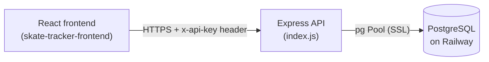
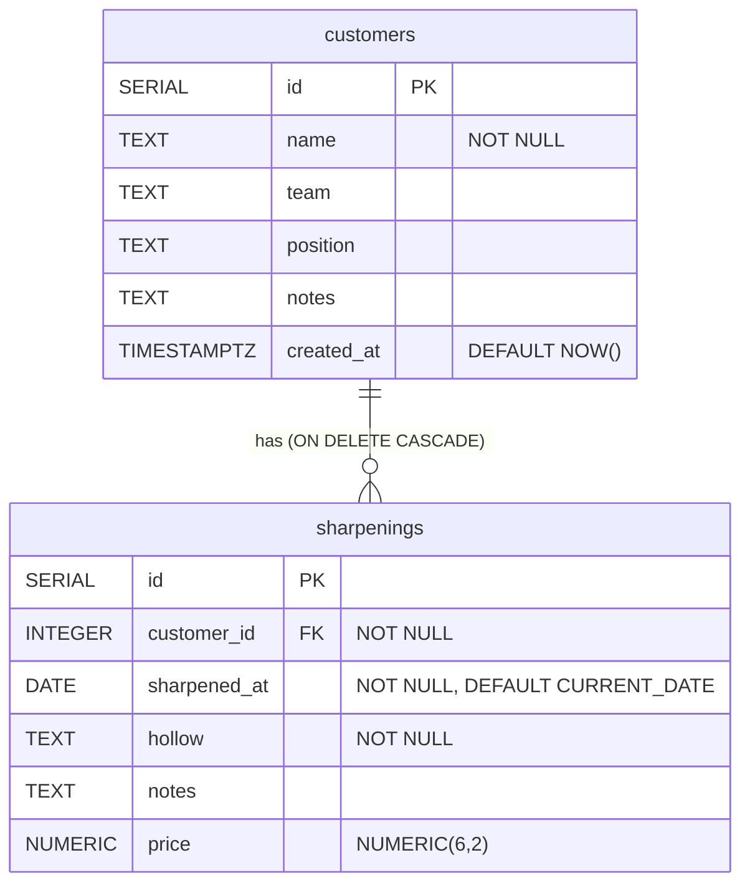

# Skate Sharpening Tracker

A REST API for tracking ice skate sharpenings, including which hollow each customer uses. Over time it builds real data on hollow preferences by position.

## Tech stack

- Node.js and Express
- PostgreSQL (hosted on Railway)
- `pg` for database access, `dotenv` for configuration, `cors` for cross-origin access

The React front end that consumes this API lives in [caboobie/skate-tracker-frontend](https://github.com/caboobie/skate-tracker-frontend).

## Architecture



## Database schema



## Setup

1. Install dependencies:
   ```
   npm install
   ```
2. Create a `.env` file (no quotes around values) with the environment variables below:
   ```
   DATABASE_URL=your_public_postgres_url
   API_KEY=your_secret_key
   FRONTEND_URL=http://localhost:5173
   ```
3. Start the server:
   ```
   node index.js
   ```
   The server runs on port 3000 by default (or `PORT` if set). Tables are created automatically on startup.

## Environment variables

| Variable | Description |
|----------|-------------|
| `DATABASE_URL` | Postgres connection string. SSL is enabled with `rejectUnauthorized: false` |
| `API_KEY` | Secret required in the `x-api-key` header on every `/api` request except `/api/health`. If unset, all protected requests return `401` |
| `FRONTEND_URL` | Allowed CORS origin(s); comma-separated for several. If unset, no cross-origin requests are allowed |
| `PORT` | Port to listen on (default `3000`) |

## Authentication

All `/api` endpoints except `GET /api/health` require the header `x-api-key: <API_KEY>`. A missing or wrong key returns `401 {"error":"Unauthorized"}`.

## Data model

**customers**: `id`, `name` (required), `team`, `position`, `notes`, `created_at`

**sharpenings**: `id`, `customer_id` (foreign key, cascades on delete), `sharpened_at` (date), `hollow` (required), `notes`, `price`

Allowed hollows: `3/8`, `3/8 FIRE`, `7/16`, `1/2`, `1/2 FIRE`, `9/16`, `5/8`, `11/16`, `3/4`

## API endpoints

### Health

| Method | Endpoint | Description |
|--------|----------|-------------|
| GET | `/api/health` | Checks the database connection (no API key needed). Returns `{ "ok": true, "time": ... }` |

### Customers

| Method | Endpoint | Description |
|--------|----------|-------------|
| GET | `/api/customers?search=term` | List customers, optionally filtered by name (case-insensitive) |
| GET | `/api/customers/:id` | Get a single customer (`404` if not found) |
| POST | `/api/customers` | Create a customer. Body: `name` (required), `team`, `position`, `notes` |
| PUT | `/api/customers/:id` | Replace a customer's details. `name` is required |
| DELETE | `/api/customers/:id` | Delete a customer and their sharpenings. Returns the deleted customer |

### Sharpenings

| Method | Endpoint | Description |
|--------|----------|-------------|
| POST | `/api/customers/:id/sharpenings` | Log a sharpening. Body: `hollow` (required, must be an allowed value), `sharpened_at` (YYYY-MM-DD, defaults to today), `notes`, `price`. Returns `404` if the customer does not exist |
| GET | `/api/customers/:id/sharpenings` | A customer's history, newest first. Dates are returned as `DD/MM/YYYY` in `sharpened_on` |
| DELETE | `/api/sharpenings/:id` | Delete a sharpening. Returns the deleted record |

### Hollows and stats

| Method | Endpoint | Description |
|--------|----------|-------------|
| GET | `/api/hollows` | The list of allowed hollows |
| GET | `/api/stats/hollows` | Number of sharpenings per hollow, most common first |
| GET | `/api/stats/hollows-by-position` | Hollow counts grouped by customer position (missing positions are reported as `Unknown`) |

## Example

```
curl -X POST http://localhost:3000/api/customers \
  -H "Content-Type: application/json" \
  -H "x-api-key: $API_KEY" \
  -d '{"name":"Test Player","team":"Sharks","position":"Defence"}'

curl -X POST http://localhost:3000/api/customers/1/sharpenings \
  -H "Content-Type: application/json" \
  -H "x-api-key: $API_KEY" \
  -d '{"hollow":"1/2","price":10}'
```

## Error handling

- `401`: missing or invalid `x-api-key`
- `400`: invalid input (missing name, hollow not in the allowed list)
- `404`: customer or sharpening not found
- `500`: unexpected server error (`{"error":"Something went wrong"}`)

Errors are returned as JSON in the form `{"error":"message"}`.

## Design notes

- All queries are parameterised to prevent SQL injection.
- Hollows are validated server-side against a fixed list to keep the data consistent.
- Prices use `NUMERIC(6,2)` to avoid floating-point rounding errors.
- Dates are stored as `DATE` and formatted only for display.
